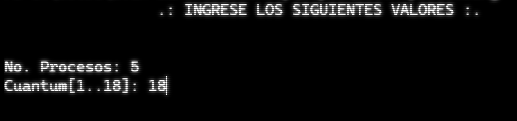

The batch procesing operating system was one of the earliest OS. It works grouping similar jobs together into batches & execute them secuentially.  

**More about batch processing OS:** [batch_processing_operating_system](https://www.tutorialspoint.com/operating_system/batch_processing_operating_system.htm)

Compile with **gcc**:  
```bash
	 g++ proceso.cpp randomnum.cpp marco.cpp main.cpp -o main
```
Then run (On Windows) `.\main.exe`


### Program Workflow
---
Jobs will execute an aritmetic operation, wich are: `+, -, \*, /`.

#### Initial screen 
Enter the number of jobs you want to run  
Quantum is used to calculate how long a job will take in the execution state in a single iteration  


####  Key options 


#### Process (or Job) States:
#### Ready Queue
Procesess to be executed
#### Execution Proccess
The current execution
#### Blocqued Queue
Process that are waiting for an I/O to get back to Ready Queue or to be suspenedd
#### Finished
Have fibnished their jobs


###  Classes
###  Proceso
Atribuites & methods for simulating a job to be executed
###  Random Num (randomnum.cpp)
Round Robin algorithm for planification

###  Marco, (Actividad 11, 14) (marco.cpp)
Memory paging into equal-size portions. Each "marco" is assigned exclusively to a single process.

Simulará la memoria, la cuál se dividirá en "marcos" - 45 marcos de 4 slots cada uno. El SO ocupara 3 marcos

Tamaño de memoria 180 en total


#### c++ error main.cpp:(.text+0x1b): undefined reference to 

Stack overflow error
https://stackoverflow.com/questions/14620435/c-error-undefined-reference-to-main
